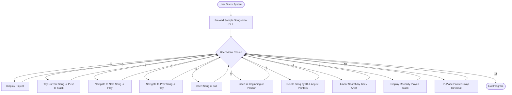

# ACADEMIC PROJECT REPORT

## TOPIC: MUSIC PLAYLIST MANAGEMENT SYSTEM
**Course:** Data Structures & Algorithms (DSA)  
**Academic Year:** 2nd Year B.Tech / B.E. (Computer Science & Engineering)  

---

### **Submitted By:**
- **Student Name:** Rishi Pandey  
- **ERP Number:** 25ET2041025  
- **Department:** Department of Computer Science & Engineering  
- **Institution:** Alard University, Pune  

---

<br>

## CERTIFICATE OF COMPLETION

This is to certify that the project entitled **"Music Playlist Management System"** is a bona fide work carried out by **Rishi Pandey (ERP No: 25ET2041025)**, a student of 2nd Year Computer Science & Engineering at **Alard University, Pune**, in partial fulfillment of the requirements for the Data Structures & Algorithms Laboratory curriculum.

<br>

**Signature of Student:** ______________________  
**Date:** 25th October 2026  

**Signature of Guide / Faculty Examiner:** ______________________  
**Department Seal:**  

---

## ACKNOWLEDGEMENT

I would like to express my sincere gratitude to my faculty mentors and the Department of Computer Science & Engineering at **Alard University, Pune**, for providing me with the opportunity and resources to develop this Data Structures & Algorithms mini project.

I am deeply thankful to my professors for their valuable guidance, constructive critique, and continuous encouragement throughout this academic term. I also extend my gratitude to my peers for their helpful suggestions during the development and testing of this application.

**Rishi Pandey**  
ERP No: 25ET2041025  
Department of CSE, Alard University Pune  

---

## TABLE OF CONTENTS
1. [Abstract](#1-abstract)
2. [Problem Statement & Objectives](#2-problem-statement--objectives)
3. [Choice of Data Structures & Theoretical Background](#3-choice-of-data-structures--theoretical-background)
4. [System Architecture & Workflow](#4-system-architecture--workflow)
5. [Algorithm Specifications](#5-algorithm-specifications)
6. [Complexity Analysis](#6-complexity-analysis)
7. [Implementation Details](#7-implementation-details)
8. [Sample Test Runs & Output](#8-sample-test-runs--output)
9. [Advantages & Limitations](#9-advantages--limitations)
10. [Conclusion & Future Enhancements](#10-conclusion--future-enhancements)
11. [References](#11-references)

---

## 1. ABSTRACT

Modern digital music streaming services such as Spotify, Apple Music, and YouTube Music require robust data management mechanisms that allow users to seamlessly browse, rearrange, and listen to audio tracks. Standard arrays fail to accommodate continuous dynamic additions and deletions of songs without costly $O(N)$ element shifts and fixed capacity issues.

This project presents a **Music Playlist Management System** developed in C++ using a **Doubly Linked List (DLL)** as the core data structure, coupled with a **Stack (LIFO)** data structure to track recently played tracks. A Doubly Linked List is optimal because each track maintains references to both its successor (`next`) and predecessor (`prev`), enabling bidirectional navigation (playing the Next song and Previous song in $O(1)$ time), rapid arbitrary insertions, and in-place list reversal. The resulting terminal-based application is memory-efficient, responsive, and adheres to 2nd-year CSE foundational algorithms.

---

## 2. PROBLEM STATEMENT & OBJECTIVES

### 2.1 Problem Statement
In audio streaming applications, playlists undergo frequent runtime operations:
- Adding tracks dynamically at any point (beginning, middle, or end).
- Removing unwanted tracks without having to reallocate or shift adjacent memory.
- Forward and backward song switching (`Next` and `Previous`).
- Remembering recently played tracks for historical auditing.

Using static arrays results in memory waste or overflow, and singly linked lists prevent direct reverse playback. Hence, an efficient pointer-based solution is required.

### 2.2 Project Objectives
1. Implement a Doubly Linked List to store and navigate song items (`Song* next`, `Song* prev`).
2. Provide bidirectional playback features (Next Song, Previous Song, and Loop Around).
3. Support arbitrary insertions (beginning, middle, end) and deletions by unique Song ID.
4. Integrate a Stack data structure to record the history of played songs in Last-In-First-Out (LIFO) order.
5. Provide in-place pointer reversal of the playlist without auxiliary array copies.
6. Design an interactive, user-friendly command-line interface (CLI) suitable for academic evaluation.

---

## 3. CHOICE OF DATA STRUCTURES & THEORETICAL BACKGROUND

### 3.1 Why Doubly Linked List (DLL)?
| Feature | Static Array / `std::vector` | Singly Linked List | Doubly Linked List (Chosen) |
| :--- | :--- | :--- | :--- |
| **Next Track Navigation** | $O(1)$ index access | $O(1)$ via `next` pointer | $O(1)$ via `next` pointer |
| **Previous Track Navigation** | $O(1)$ index access | $O(N)$ (requires full re-traversal) | **$O(1)$ via `prev` pointer** |
| **Insertion at Head/Tail** | $O(N)$ (at head) | $O(1)$ | **$O(1)$ with head & tail pointers** |
| **Arbitrary Deletion** | $O(N)$ (element shifting) | $O(N)$ traversal | **$O(1)$ pointer relink once found** |
| **Dynamic Memory Allocation** | Reallocation overhead | Node-by-node allocation | **Flexible node-by-node allocation** |

Each song node is defined as:
```cpp
struct Song {
    int id;
    string title;
    string artist;
    double duration;
    Song* prev;
    Song* next;
};
```

### 3.2 Why Stack for Recently Played History?
A Stack operates on the **Last-In, First-Out (LIFO)** principle. Whenever a song is played, it is pushed onto the stack. When the user requests their playback history, the most recently played songs appear at the top of the list, which mimics real-world media player behavior.

---

## 4. SYSTEM ARCHITECTURE & WORKFLOW



---

## 5. ALGORITHM SPECIFICATIONS

### 5.1 Insertion at Tail (`addSongEnd`)
1. Allocate memory for a new `Song` node: `newNode`.
2. Initialize `newNode->next = nullptr` and `newNode->prev = nullptr`.
3. If `head == nullptr` (playlist is empty):
   - Set `head = tail = currentSong = newNode`.
4. Else:
   - Set `tail->next = newNode`.
   - Set `newNode->prev = tail`.
   - Set `tail = newNode`.
5. Increment `totalCount` by 1.

### 5.2 Next Track Playback (`playNext`)
1. If `currentSong == nullptr`, report empty playlist.
2. If `currentSong->next != nullptr`:
   - Update `currentSong = currentSong->next`.
3. Else:
   - End of playlist reached; wrap around: `currentSong = head`.
4. Call `playCurrent()`:
   - Output song metadata.
   - Push song title and artist to `history` stack.

### 5.3 Deletion by Song ID (`deleteSongById`)
1. Traverse the list starting from `head` using pointer `curr` until `curr->id == id` or `curr == nullptr`.
2. If `curr == nullptr`, notify that the track ID does not exist.
3. If `curr == currentSong`, advance `currentSong` to `curr->next` (or `curr->prev` if at the end).
4. Relink adjacent nodes:
   - If `curr == head`, update `head = head->next`, `head->prev = nullptr`.
   - If `curr == tail`, update `tail = tail->prev`, `tail->next = nullptr`.
   - Otherwise, `curr->prev->next = curr->next` and `curr->next->prev = curr->prev`.
5. Free allocated node memory: `delete curr`.
6. Decrement `totalCount` by 1.

### 5.4 In-Place Playlist Reversal (`reversePlaylist`)
1. Initialize pointer `curr = head` and temporary pointer `temp = nullptr`.
2. While `curr != nullptr`:
   - Swap `curr->prev` and `curr->next`:
     - `temp = curr->prev`
     - `curr->prev = curr->next`
     - `curr->next = temp`
   - Advance `curr` to the next original node: `curr = curr->prev`.
3. Update `tail = head` and `head = temp->prev`.

---

## 6. COMPLEXITY ANALYSIS

| Operation | Time Complexity | Auxiliary Space Complexity | Explanation |
| :--- | :--- | :--- | :--- |
| **Add Song at Tail** | $O(1)$ | $O(1)$ | Direct access via `tail` pointer |
| **Add Song at Head** | $O(1)$ | $O(1)$ | Direct access via `head` pointer |
| **Add at Position $K$** | $O(K) \approx O(N)$ | $O(1)$ | Traversal of $K$ nodes before pointer swap |
| **Play Next / Previous** | $O(1)$ | $O(1)$ | Single pointer hop (`next` or `prev`) |
| **Delete Song by ID** | $O(N)$ search + $O(1)$ unlinking | $O(1)$ | Traversal to find ID, instant pointer relinking |
| **Search by Keyword** | $O(N)$ | $O(1)$ | Linear scan across all song nodes |
| **In-Place Reversal** | $O(N)$ | $O(1)$ | Single pass swapping pointers for every node |
| **Push to History Stack** | $O(1)$ | $O(1)$ | Linked stack push at the top |

---

## 7. IMPLEMENTATION DETAILS

The project is coded in standard modern C++ (C++17) in a single modular file `main.cpp` for simplicity of compilation and lab viva demonstration.

### Key Classes & Structures:
1. `struct Song`: Contains track metadata (ID, title, artist, duration) and self-referential pointers `prev` and `next`.
2. `class RecentlyPlayedStack`: Custom stack implemented with dynamic linked nodes (`HistoryNode`) following LIFO mechanics.
3. `class MusicPlaylist`: Encapsulates head/tail management, traversal state (`currentSong`), input sanitation, and formatting routines.

---

## 8. SAMPLE TEST RUNS & OUTPUT

### 8.1 Playlist Display
```text
===============================================================================
                         CURRENT MUSIC PLAYLIST                                
===============================================================================
ID      Title                     Artist                Duration    Status
-------------------------------------------------------------------------------
101     Bohemian Rhapsody         Queen                 5.55        [* PLAYING]
102     Hotel California          Eagles                6.30           -
103     Shape of You              Ed Sheeran            3.53           -
104     Kesariya                  Arijit Singh          4.28           -
105     Starboy                   The Weeknd            3.50           -
===============================================================================
 Total Songs: 5 | Total Duration: 23.16 mins
```

### 8.2 Track Navigation (Next & History)
```text
=======================================================
                 >>> NOW PLAYING <<<                   
 Track ID  : #102
 Title     : Hotel California
 Artist    : Eagles
 Duration  : 6.30 mins
=======================================================

=======================================================
           RECENTLY PLAYED HISTORY (STACK - LIFO)      
=======================================================
 1. Hotel California - Eagles
 2. Bohemian Rhapsody - Queen
=======================================================
```

---

## 9. ADVANTAGES & LIMITATIONS

### Advantages:
1. **Constant Time Traversal:** Moving forward or backward takes $O(1)$ constant time.
2. **Zero Memory Waste:** Memory is dynamically allocated when a song is created and deallocated immediately upon deletion.
3. **Robust Input Handling:** Safeguards against non-numeric inputs and invalid indices.

### Limitations:
1. Random access by index requires $O(N)$ traversal, unlike an indexed array.
2. Extra memory overhead per song node due to two 64-bit pointers (`prev` and `next`).

---

## 10. CONCLUSION & FUTURE ENHANCEMENTS

### 10.1 Conclusion
The **Music Playlist Management System** successfully demonstrates the practical implementation of Doubly Linked Lists and Stacks in a real-world software simulation. It addresses the limitations of contiguous static arrays by offering bidirectional playback, rapid insertions/deletions, and low computational overhead.

### 10.2 Future Enhancements
- **Persistent Storage:** Integrating file I/O (CSV or JSON) to save and reload playlists between sessions.
- **Audio Decoding Integration:** Utilizing libraries such as `SDL2_mixer` or `miniaudio` to play actual `.mp3` / `.wav` audio files.
- **Priority / Favorites Queue:** Using a Max-Heap or Priority Queue to rank most played tracks.

---

## 11. REFERENCES
1. Cormen, T. H., Leiserson, C. E., Rivest, R. L., & Stein, C. (2009). *Introduction to Algorithms* (3rd ed.). MIT Press.
2. Weiss, M. A. (2014). *Data Structures and Algorithm Analysis in C++* (4th ed.). Pearson.
3. Stroustrup, B. (2013). *The C++ Programming Language* (4th ed.). Addison-Wesley.
